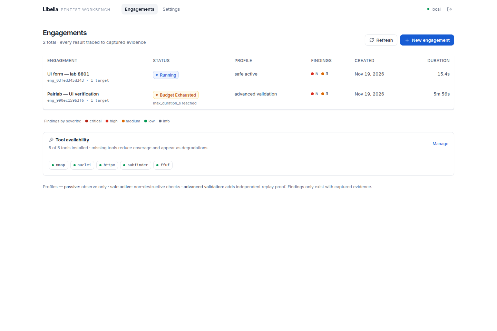
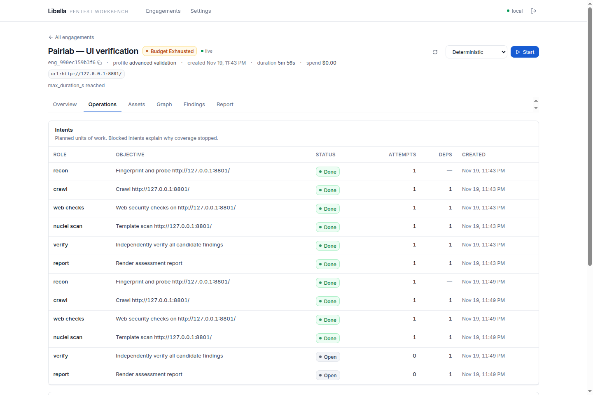
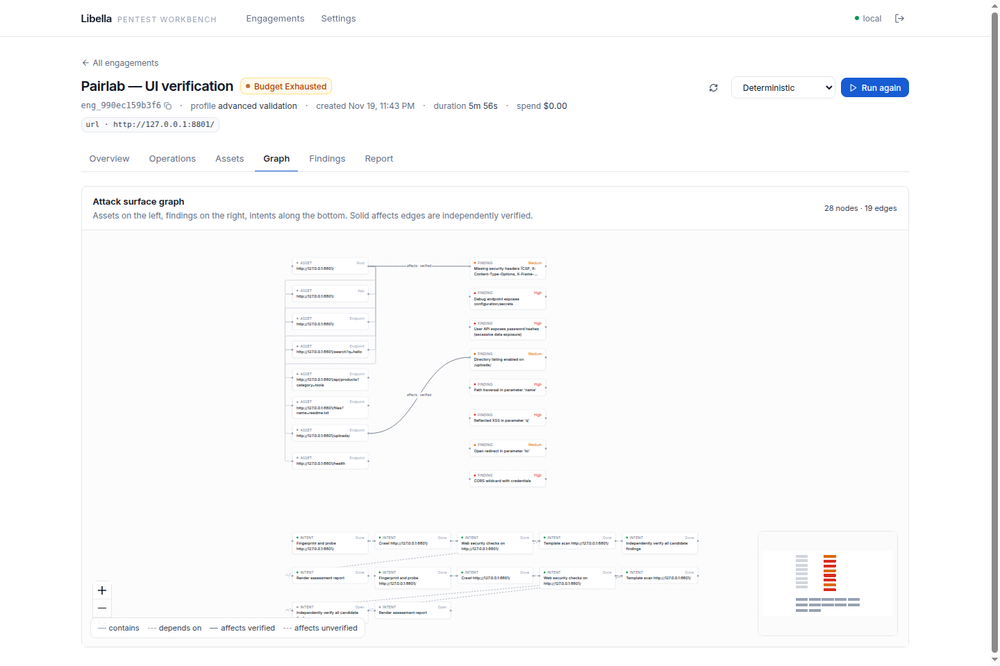
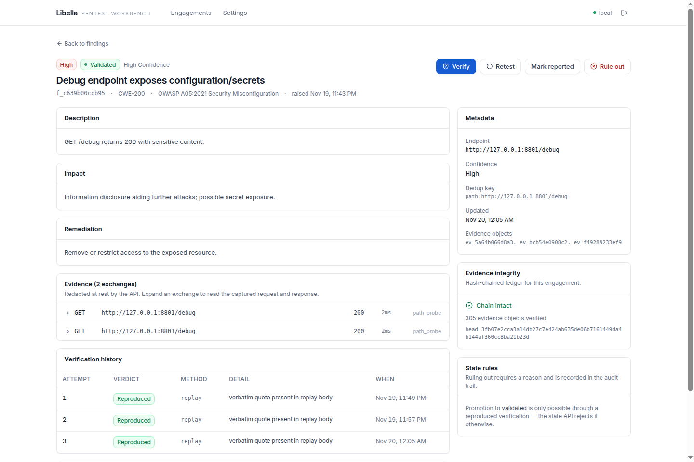
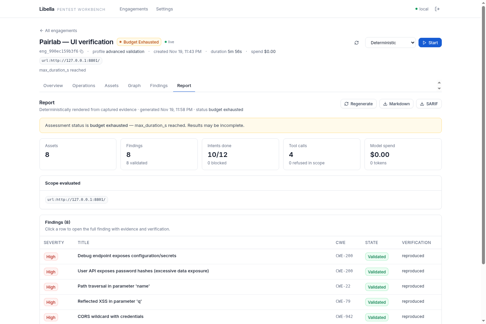
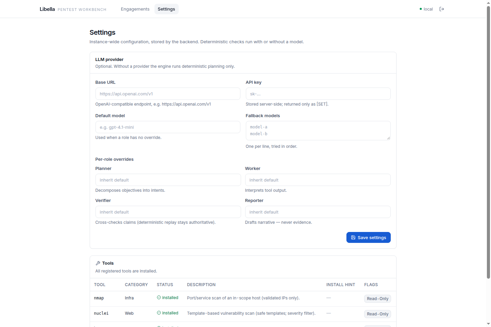

# Libella

Autonomous penetration-testing workbench. Evidence-first, scope-enforced, multi-agent.

Libella plans, executes, verifies, and reports authorized security assessments.
It is not a chatbot that runs security commands, and not a scanner wrapper.
Every finding must survive independent replay verification before it is
called validated. Every network action is checked against an enforceable
engagement authorization object before it executes.

> For systems you own or are explicitly authorized to test. Libella enforces
> scope in code, but authorization is your responsibility. See SECURITY.md.

## What makes it different

- **Scope is code, not prompt.** Targets, exclusions, ports, categories, time
  window, rate and budget limits live in an engagement authorization object.
  The tool execution layer resolves DNS and checks every target (including
  redirect hops and post-connect peer IPs) before execution. Refusals are
  audited. Prompts derive from the scope object; they never replace it.
- **Verified means reproduced now.** Candidate findings carry a replayable
  proof request and a verbatim evidence quote. An independent verifier
  re-issues the request and compares the fresh response. No replay, no
  promotion. Scanner banners and version strings are observations, never
  automatic findings.
- **Tamper-evident evidence.** Content-addressed blobs with an append-only
  hash chain. Integrity is re-checked on every read; chain breaks fail closed.
- **Typed tools, no shell.** Adapters build argv from validated, typed
  parameters. There is no free-text argument that reaches a command line and
  no generic shell tool exposed to the model.
- **Deterministic core, optional LLM planning.** The full assessment pipeline
  runs without any model (reproducible, benchmarkable, offline). An LLM
  planner can add investigation intents through a compile gate that re-checks
  scope and rejects invalid proposals.
- **One container, one file of state.** SQLite + evidence directory. No
  Postgres, no Temporal, no queue service. `docker compose up` and go.

## Verified results (real execution, not claims)

PairLab benchmark (labs/pairlab): a vulnerable/hardened twin app with 13
seeded vulnerability classes and machine-readable ground truth.

| Mode | Seeded vulns detected + independently validated | False positives | Duration |
|---|---|---|---|
| Vulnerable twin | 16 / 16 | 0 | ~158s (with nuclei) / ~9s (deterministic only) |
| Hardened twin | 0 (correct) | 0 | ~158s / ~8s |

Evidence hash chains intact across all runs. Reproduce:

```bash
python labs/pairlab/app.py                      # vuln  :8801
LAB_MODE=hardened LAB_PORT=8802 python labs/pairlab/app.py
python labs/pairlab/verify_ground_truth.py      # lab self-check
python benchmarks/run_pairlab.py --mode both
```

Additional verified benchmarks (v0.2, all with vulnerable/hardened twins):

| Suite | Result |
|---|---|
| TLS audit (tlslab) | expired cert, hostname mismatch, TLSv1/1.1 findings independently re-verified; hardened 0 |
| Code + supply chain (vulnrepo/cleanrepo) | 6/6 seeded code issues; 0 FP on clean repo; OSV dependency CVEs stay observations, never auto-confirmed |
| OpenAPI API audit (apilab) | 5/5: BOLA, BFLA, mass assignment, excessive exposure, missing auth; hardened 0 FP |
| GraphQL audit (graphlab) | 7/7: introspection, field authz, injection, depth/alias/batch abuse; hardened 0 FP |
| Browser crawl (Playwright) | Juice Shop: 9 rendered pages, 36 runtime API requests, 7 live /rest/ endpoints; screenshot evidence |
| Container image (trivy) | real local-image scan; version-based CVEs are observations, not confirmed findings |

Measured performance (PairLab, deterministic + nuclei, no LLM): 153.7s wall,
platform CPU 0.5s, scanner subprocess CPU 19.3s, platform peak RSS 60.4MB.
Reproduce: `python benchmarks/measure_perf.py`.

See CAPABILITIES.md for the full tested/planned matrix and benchmark details.

## Screenshots (real application, real assessment data)

| Dashboard | Live operations |
|---|---|
|  |  |

| Intelligence graph | Finding + evidence |
|---|---|
|  |  |

| Report | Settings |
|---|---|
|  |  |

## Quickstart (Docker)

```bash
git clone https://github.com/Shanmukh-l33t/libella && cd libella
export LIBELLA_TOKEN=*** rand -hex 24)
docker compose up -d --build
# UI + API at http://127.0.0.1:8787 (loopback-only by default)
```

Open the UI, enter the token, create an engagement against a lab target
(e.g. OWASP Juice Shop on 127.0.0.1:3001), start it, watch live operations,
inspect findings and evidence, export the report.

## Quickstart (development)

```bash
# backend (Python 3.12+)
python -m venv .venv && . .venv/bin/activate
pip install -e ".[dev]"
python -m libella.main --port 8787 --data-dir ./data
# In a second private terminal, display the token for this instance:
libella --data-dir ./data --show-token

# frontend (Node 22+)
cd web && npm ci && npm run build   # built UI served by backend at /
# or: npm run dev                   # Vite dev server proxies /api to :8787

# tests
python -m pytest tests/ -q
```

Optional scanner toolchain (the platform degrades loudly without them):
nmap, nuclei (+ templates), ProjectDiscovery httpx, subfinder, ffuf.
Availability is probed at startup and shown in Settings.

## Configure a model (optional, for LLM planning)

Open **Settings → AI provider**. Use **Test connection** to validate the
model and key before saving. See [provider setup](docs/provider-connection.md)
for custom endpoints and what the check proves. Per-role model selection and
fallback are optional; deterministic mode needs no model.

## Architecture

Single Python process (FastAPI) + embedded SQLite (WAL) + content-addressed
evidence store + static React UI. Supervisor planner emits leased worker
intents (fencing tokens, expiry sweep, bounded retries). Workers execute
typed tool adapters and deterministic checks. An independent verifier
replays proof requests. Reports render deterministically from typed state
(Markdown, JSON, SARIF) with secret redaction.

Read ARCHITECTURE.md for the decision record and THREAT_MODEL.md for the
security model and known limits.

## Safety model (summary)

- Fail-closed scope: empty scope is rejected at creation.
- Metadata/link-local ranges blocked unless explicitly targeted.
- Per-engagement rate, concurrency, duration, and cost budgets.
- Profiles: passive, safe_active, advanced_validation (explicit opt-in).
- Emergency stop: cancel propagates to intents and subprocesses.
- Localhost-only bind by default; token auth on every API route.
- Credentials redacted from logs, evidence views, and reports.
- Target content is untrusted data; it cannot mutate canonical state.

## Project status

Working and benchmarked: genuine autonomous specialist agent runtime (ReAct
investigation, hypotheses, evidence-gated conclusions, delegation, cost-aware
model routing, duplicate-action convergence) achieving 16/16 lab coverage with
independent validation; deterministic baseline (16/16, 0 FP); scope enforcement;
recon; static + authenticated browser crawling; traffic intelligence + authorized
replay; web (16 classes), OpenAPI API (5), GraphQL (7), TLS, source/supply-chain
(6 + OSV), AWS cloud posture (moto-verified), container scanning, technology-
specific modules (WordPress/PHP/Java/ColdFusion/Node/IIS/Apache/Nginx), ZAP
adapter, plugin/MCP extension framework; deep investigation graph + cross-run
memory + drift; independent verification + retest; PDF/MD/JSON/SARIF reports +
remediation tracking + historical comparison; premium operational UI (Command
Center, Agent Operations, Traffic, Tool Center, Evidence, Remediation, Graph).
448 tests; two independent adversarial audits (35 defects fixed). CI/issue-tracker
hooks and scheduled retest are planned, not claimed. See CAPABILITY_MATRIX.md.

## License

Apache-2.0. See LICENSE and NOTICE. Security tool binaries (nmap, nuclei,
sqlmap-adjacent, etc.) carry their own licenses; Libella invokes them as
subprocesses and does not link them.

## Contributing / Security

CONTRIBUTING.md for development workflow. SECURITY.md for the disclosure
policy and the authorization requirements.